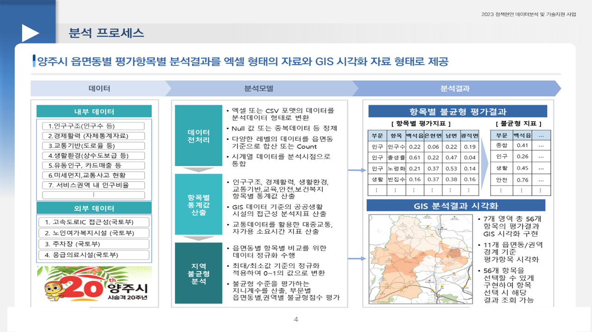
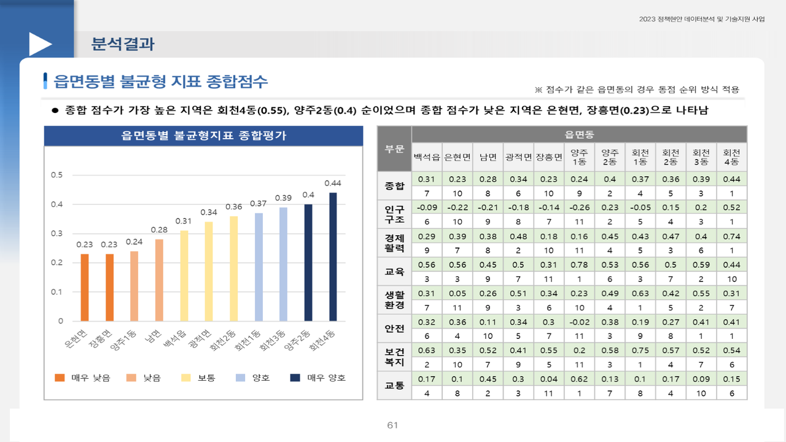

# 양주시 지역 내 불균형 실태분석

2023.06 – 2023.07 · 라임솔루션 (발주처: 경기 양주시) · 역할: 전 과정 (56개 지표 체계 설계 · 표준화 · 지니계수 · GIS · 결과보고서), 단독 수행

## 프로젝트 소개
신도시 등 대규모 개발로 기반시설·생활편의시설이 특정 지역에 편중됐다는 민원이 늘었지만, 양주시는 불균형 실태를 데이터로 진단한 적이 없었다. 7개 분야 56개 지표로 읍·면·동(11개) 및 권역별 불균형 수준을 측정하는 **지역불균형 평가체계**를 설계·구축했다 (분석방안 2023.05.12, 추가지표 방안 2023.06.07, 2024.12까지 추가 문의 대응).
이 레포는 분석에 사용한 Jupyter 노트북 7개(출력 제거)와 지표 구조를 보여주는 합성 샘플로 구성한다.

## 문제 정의
- 배경: 대규모 개발로 생활 인프라가 편중됐다는 민원 증가, 데이터 기반 진단 부재
- 질문: 읍·면·동 및 권역별로 분야별 불균형 수준은 얼마이고, 어디가 어느 분야에서 취약한가

## 데이터
| 데이터 | 출처 | 규모 | 공개 여부 |
|---|---|---|---|
| 7개 분야 56개 지표 원천(인구·사업체·학교·의료·소방·도로 등) | 양주시 내부 + 공공데이터 | 읍면동 11개 | 낮음~중, 레포 미포함 |
| KT 유동인구, BC카드 매출(성연령·요일·시간대·유입지별) | 통신사·카드사 | 2023.05 기준 | 계약 데이터, 비공개 |
| 경로당 현황(회장 성명·연락처 포함) | 양주시 | 시설 단위 | 개인정보 포함, 비공개 |
| 공공시설 서비스권역, 행정경계 | 국토부·통계청 | - | 공공 |

- **원천 데이터·중간 산출물은 포함하지 않는다.** 노트북이 읽는 `../P1_Data/...`, `C://j_code//2023//A22//...` 경로는 원본 그대로 두었다.
- 지표 구조 확인용 **합성 샘플** `data/sample/indicators_sample.csv`(11개 읍면동 × 56개 지표, numpy seed 42 난수)를 제공한다. 지표명은 7개 분야를 따라 일반화한 예시이며 실제 지표 정의·값과 다르다.

## 분석 방법
1. **지표 체계**: 인구구조·경제활력·생활환경·교통·교육·안전·보건복지 7개 분야 56개 지표 설계
2. **표준화**: 역방향 지표(노령화지수·빈집 비율 등)는 음수 변환으로 방향성을 통일하고 Min-Max 정규화(0–1)
3. **격차 측정**: 지니계수 산출 로직을 직접 구현(Lorenz 곡선 아래 면적 기반), Lorenz Curve로 항목별 격차 비교
4. **종합 점수**: 분야별 점수 → 종합 불균형 점수, 읍면동 등급화
5. **GIS**: 공공시설 서비스권역(버퍼 기반 도달 가능 권역)과 100m 격자 인구를 겹쳐 생활환경·보건복지 접근성 지표 생성, 취약지역 지도화


### 노트북 구성 (`notebooks/`)
| 파일 | 내용 |
|---|---|
| `01_demographic_structure_hjd.ipynb` | 읍면동(행정동) 단위 지표 원천 정리·산출·Min-Max 표준화 |
| `02_demographic_structure_rei.ipynb` | 권역 단위 지표 산출·표준화 |
| `03_Gini_coefficient.ipynb` | 항목별 지니계수 함수 구현, 분야별·종합 불균형 점수 |
| `04_PRE_SERVICE.ipynb` | 서비스권역 분석용 행정경계·격자 인구·권역코드 전처리 |
| `05_SERVCE.ipynb` | 시설 버퍼(서비스권역)와 격자 인구 overlay로 접근성(권역 내 인구 비율) 산출 |
| `06_HJD_GEO.ipynb`, `06_REI_GEO.ipynb` | 읍면동·권역 결과를 행정경계에 결합해 GIS 레이어 생성 |

## 기술 스택
Python, Pandas, GeoPandas(버퍼·overlay), Scikit-learn(MinMaxScaler), Excel, QGIS

## 결과
- 7개 분야 56개 지표 기반 **지역불균형 평가체계** 구축, 읍면동별 종합점수와 분야별 취약영역 비교(예: 회천3동)
- 지역균형 정책 우선 검토지역 제시, 2024.12 양주시 추가 문의에 답변 자료 제공
- 이 프로젝트의 "지표 정의·표준화" 경험이 이후 분석(시흥 SOC, 석사연구 2SFCA의 지니계수·Lorenz)으로 이어짐




## 실행 방법
- 환경: Python 3.9, Jupyter, `pandas geopandas shapely scikit-learn openpyxl matplotlib`
- 노트북은 원 프로젝트 폴더 구조(`P1_Data/`, `P3_Result/`)를 전제로 하므로, 각 노트북 상단의 `path_*` 변수와 `read_excel/read_csv/read_file` 경로를 **환경에 맞게 수정**해야 한다.
- 순서: `04_PRE_SERVICE` → `05_SERVCE`(접근성 지표) → `01`/`02`(지표 산출·표준화) → `03_Gini_coefficient`(지니·종합점수) → `06_*_GEO`
- 샘플 `indicators_sample.csv`로는 `03_Gini_coefficient.ipynb`의 `gini(df)`·`apply_minmax_scaler(df)` 함수 동작을 확인할 수 있다.

## 폴더 구조
```
yangju-regional-imbalance/
├── README.md
├── .gitignore
├── notebooks/            # 노트북 7개 (출력 셀 제거)
├── data/sample/
│   ├── indicators_sample.csv
│   └── README.md
└── docs/images/          # 결과 캡쳐
```

## 참고
- Obsidian 노트: `2023-06_양주시_지역불균형_실태분석`
- 관련 레포: `siheung-cultural-soc`(지니계수·Lorenz 재사용)
- 공식 결과보고서와 원천 데이터, QGIS 프로젝트(.qgz)는 발주처 자료로 **비공개**이며 포함하지 않는다.
